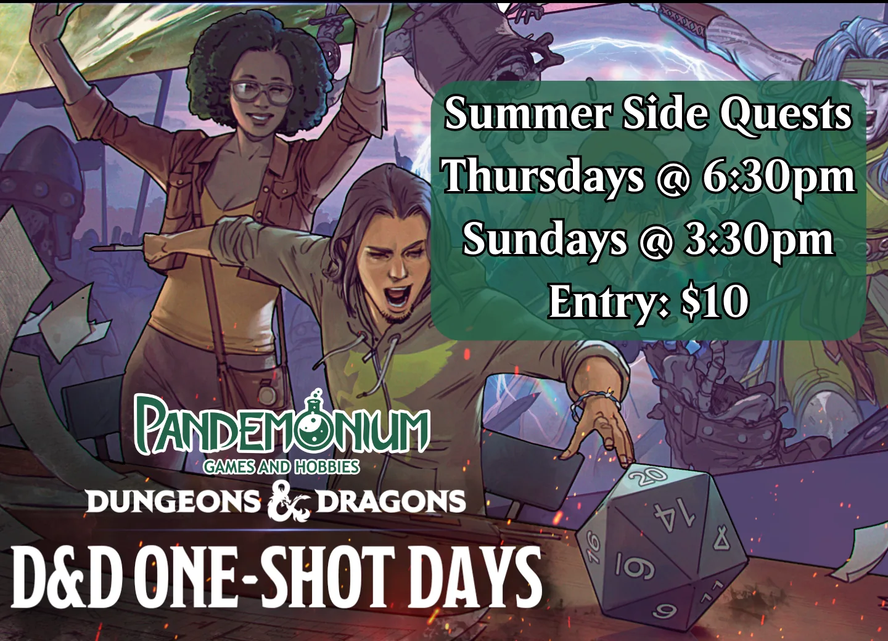

  <h1>Pando DnD</h1>
  
Both Online and at <a href="https://pandogames.com/">Pandemonium Games and Hobbies</a>

Pando DnD started as a group gaming at Pandemonium Games and Hobbies, and we've since branched out to run online tables too &mdash; wherever you play, everyone's welcome. We're not officially run by Pandemonium, but we're happy regulars, and we recommend them as a friendly, welcoming local game store.

## When We Play

  

    
Wednesdays

    <h3>Online Games</h3>
    
7pm&ndash;9pm via Discord. Sign up on Warhorn to grab a seat at a table.

    <a href="https://warhorn.net/events/pandodnd">Sign up on Warhorn &rarr;</a>
  

  

    
Fridays

    <h3>In-Person Games</h3>
    
Limited seating &mdash; one table at Pandemonium Games. Currently running the <a href="https://hoshisabi.com/rpg/icewind-dale/public/">Icewind Dale campaign</a>.

    
To join, connect on <a href="https://discord.gg/dbB5RYH5P7">Discord</a> and contact hoshisabi.

  

## D&D One-Shot Days at Pandemonium

  <!-- TODO: add flyer at media/dnd-summer-side-quests.webp, then uncomment
  
  -->
  
Pandemonium is running a <strong>D&amp;D One-Shot Series &mdash; Summer Side Quests</strong>! DMs Vanya and Andrew are back to guide new and experienced players alike through some fun, casual D&amp;D. This one's organized by the store, not Pando DnD, but it's a great way to get more games in.

  <ul>
    <li>Thursdays at 6:30pm and Sundays at 3:30pm</li>
    <li>Entry is $10 per session</li>
    <li>Each session is a stand-alone one-shot &mdash; sign up for all of them or just pop in and play</li>
    <li>Pregenerated characters provided</li>
    <li>Preregister to reserve your spot &mdash; seats are limited</li>
  </ul>
  <a href="https://pandogames.com/pages/events">Check Pandemonium's event listings &rarr;</a>

## Find Us

  

    <h3>PandoDnD</h3>
    <ul>
      <li><a href="https://warhorn.net/events/pandodnd">Warhorn (sign up)</a></li>
      <li><a href="https://discord.gg/dbB5RYH5P7">Discord</a></li>
      <li><a href="https://www.facebook.com/groups/PandoDnD">Facebook Group</a></li>
      <li><a href="https://hoshisabi.com/rpg/icewind-dale/public/">Icewind Dale Campaign</a></li>
    </ul>
  

  

    <h3>Pandemonium Games and Hobbies</h3>
    <ul>
      <li><a href="https://pandogames.com/">Store</a></li>
      <li><a href="https://www.facebook.com/PandoGames">Facebook</a></li>
      <li><a href="https://discord.com/invite/knY4MDnsuF">Discord</a></li>
      <li><a href="https://pandogames.com/pages/events">Events Calendar</a></li>
    </ul>
  

